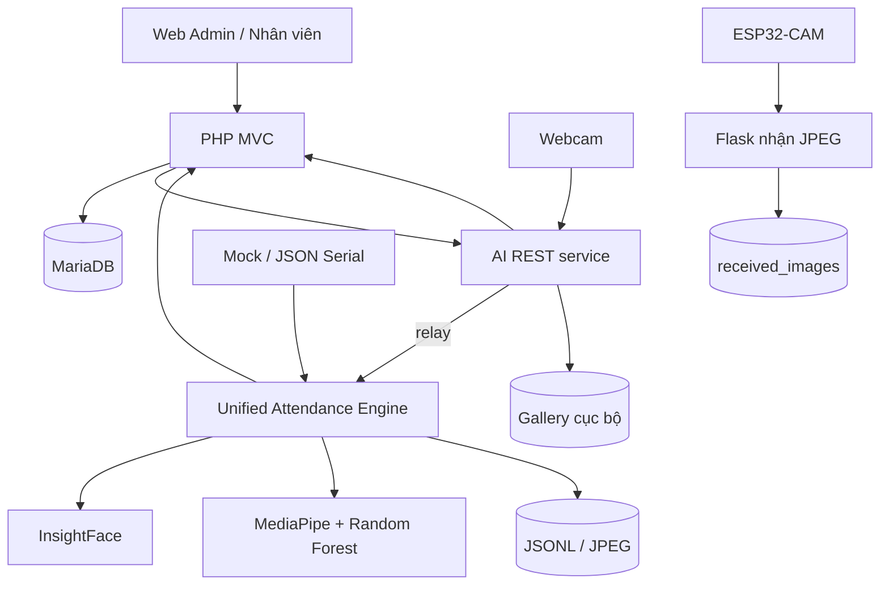
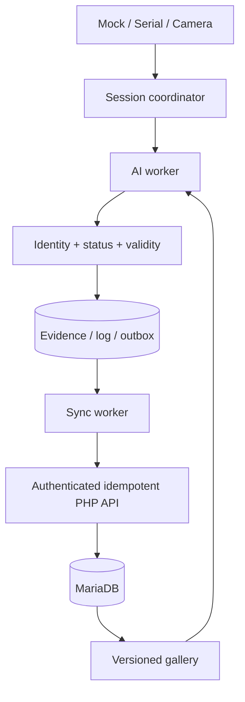

# Báo cáo kiểm toán và khắc phục PBL4 — 19/10/2026

Mốc kiểm toán ban đầu: commit `5a09099`. Báo cáo này thay bốn báo cáo kiến trúc/kỹ thuật/AI cũ; README hướng dẫn sử dụng được giữ và cập nhật. Không chứa thông tin truy cập hoặc dữ liệu cá nhân.

> **Cập nhật vận hành 20/10/2026:** Task 1–6 đã sửa mã và chạy hồi quy local theo nhật ký cuối báo cáo. Web PHP 8.2/MariaDB 10.11, InsightFace/MediaPipe thật và webcam laptop/USB đã kiểm chứng ở phạm vi mô tả dưới đây; PHP đã nhận JPEG qua AI. Đã backup rồi áp migration cộng thêm vào DB hiện tại, bảo toàn số dòng cũ. Chưa có model RF v2 từ người thật, chưa nghiệm thu phiên chấm công người thật/cảm biến/ESP32 và CI GitHub. Các nhận định “chưa” trong mục kiểm toán ban đầu/nhật ký cũ là trạng thái tại thời điểm đó; mốc hiện hành là Task 6.

## 1. Executive summary

Hệ thống gồm Web PHP/MariaDB, ứng dụng AI Python và firmware ESP32-CAM. Đã có nhận diện mặt, phân tích chuỗi ảnh, đăng ký mặt, quản lý nhân viên/ca, chấm công, monitoring và bằng chứng. Chưa đủ bằng chứng vận hành toàn hệ thống. Ưu tiên sửa tính đúng của AI và phiên chấm công, sau đó bảo mật, lưu trữ, triển khai và vận hành.

## 2. Project architecture

- `DoAn_ChamCong_AI/index.php`: router và session; `Controller`, `Service`, `Model`, `View`: Web MVC.
- `pbl4-face-ai/unified_engine.py`: phiên 3 ảnh cách nhau tối thiểu 300 ms, nhận diện, thể trạng, fusion, đồng bộ.
- `ai_web_service.py`: camera relay, enrollment, gallery; `src`: thuật toán AI, CLI, train/evaluate.
- `gui.py`, `gui_register.py`, `demo_unified_iot.py`: giao diện desktop và demo.
- `PhanCung/GuiAnhLenServer_2`: firmware camera; `esp32_server/app.py`: nhận ảnh. Chưa thấy firmware MAX30102 tương ứng với giao thức phiên trong tài liệu cũ.
- Công nghệ: PHP 8.2 trong Dockerfile, MariaDB 10.11 trong Compose; Python/OpenCV/InsightFace/ONNX Runtime/MediaPipe/scikit-learn/Flask; Arduino C++.

## 3. Feature inventory

| Nhóm | Entry point | Trạng thái kiểm toán ban đầu |
|---|---|---|
| Login, RBAC, nhân viên/tài khoản | PHP Auth/Employee controllers | Có code, chưa kiểm chứng runtime |
| Ca/phân ca | ShiftController/ShiftModel | Có code, không hỗ trợ qua đêm |
| Check-in/out và bằng chứng | AttendanceController/AttendanceService | Có lỗi schema, concurrency, idempotency, xác thực |
| Monitoring và trang cá nhân | MonitoringController/MyController | Có code; phụ thuộc schema |
| Enrollment Web 5 hướng | FaceEnrollmentController/AI REST | Capture chưa kiểm tra lại pose/số mặt |
| Enrollment desktop/CLI | gui_register.py, src/register.py | Có code; nhiều nơi ghi gallery |
| AI 1 nhận diện/xác minh | src/face_engine.py, src/verify.py | Có code, chưa đánh giá độc lập runtime |
| AI 2 thể trạng | src/predict_status.py | Có lỗi đổi dữ liệu không hợp lệ thành Normal ở engine |
| Thu dữ liệu/train/evaluate | scripts/collect_status.py, src/train_rf.py, src/evaluate.py | Có công cụ, chưa xác minh chất lượng model |
| IoT mock/Serial | demo_unified_iot.py | Có consumer Serial; chưa có producer cảm biến trong repo |
| ESP32-CAM HTTP/stream/upload | PhanCung | Có code; chưa kiểm chứng thiết bị thật |

## 4. Completeness assessment

Kiểm toán ban đầu: 20 file Python parse AST thành công; 5 JavaScript qua `node --check`; 96 đường dẫn require PHP tồn tại; Compose parse được. Có 153 dòng JSONL hợp lệ và 240 tham chiếu snapshot tồn tại, nhưng không chứng minh dùng cảm biến thật hoặc Web đã nhận.

Virtualenv cũ trỏ tới interpreter không tồn tại. Docker daemon không hoạt động. PHP CLI có tại `C:/xampp/php/php.exe` (phát hiện trong giai đoạn khắc phục). Không đánh đồng syntax, build, unit tests và runtime tích hợp.

## 5. Technical audit — danh mục cần theo dõi

| ID | Mức | Bằng chứng ban đầu và hậu quả | Hướng khắc phục |
|---|---|---|---|
| T01 | Critical | Schema thiếu TheTrang, TheTrangVao/Ra nhưng model truy vấn | Schema mới và migration nâng cấp |
| T02 | Critical | recordApi nhận mã nhân viên/ảnh/chỉ số không xác thực | Xác thực service; validation; không tự tạo nhân viên |
| T03 | High | done_session và update cùng finalize | State ownership/guard, event ID, kiểm thử concurrency |
| T04 | High | Unknown/lỗi AI thành Normal; thiếu IoT vẫn GREEN | Giữ is_valid/Unknown và lý do thiếu dữ liệu |
| T05 | High | Gửi lại request có thể biến vào thành ra | Idempotency key và khóa nghiệp vụ DB |
| T06 | High | sync_faces_to_db xóa toàn bộ lịch sử trước khi kiểm tra input | Loại reset khỏi đồng bộ, transaction |
| T07 | High | Cache riêng process, ghi pickle trực tiếp, nhiều đường ghi | Atomic gallery và tự phát hiện phiên bản file |
| T08 | High | Capture luôn pose_ok; nhiều mặt chọn mặt lớn nhất | Validate trên ảnh capture, kiểm tra đồng nhất người |
| T09 | High | Gallery cho private IP, AI bind mọi interface không auth | Token, bind/network phù hợp |
| T10 | High | Chấm công commit trước sức khỏe/cảnh báo | Transaction duy nhất và rollback |
| T11 | High | Chưa giới hạn ảnh/chỉ số, mapping lạ thành bình thường | Contract và chính sách thống nhất |
| T12 | High | Credential hard-code; thư mục SQL dưới web root | Cấu hình môi trường, chặn file nội bộ |
| T13 | Medium | imwrite lỗi vẫn báo ảnh; log ghi trước web_result | Kiểm tra ghi, tên event duy nhất, outbox |
| T14 | Medium | health model_ready luôn true | Readiness thực tế |
| T15 | Medium | Thiếu dependency, virtualenv hỏng, PHP extension thiếu khai báo | Khai báo/kiểm tra môi trường |
| T16 | Medium | Bù frame thiếu; nhịp thu dữ liệu khác runtime; split theo dòng | Cùng pipeline đặc trưng/nhịp ảnh; đánh giá độc lập |
| T17 | Medium | Upload nhận mọi body và lưu không giới hạn | Auth, validate ảnh/body, retention |
| T18 | Low | Tài liệu lệch, logic lặp, class quá nhiều trách nhiệm | Báo cáo mới, module dùng chung, adapter rõ |

## 6. Performance review

Chưa có benchmark. Cần đo thời gian AI 1/AI 2/HTTP, độ trễ preview, RAM nhiều process, gallery tăng dần, truy vấn DATE(GioVao), payload danh sách nhân viên và dung lượng ảnh. Chỉ tối ưu từ kết quả đo; chưa cần vector DB hoặc hệ thống phân tán.

## 7. Improvement recommendations

A. Sửa lỗi: AI invalid, chốt phiên một lần, API idempotent, schema.
B. Tối ưu: tách inference và network khỏi vòng preview; quản lý tài nguyên.
C. Kiến trúc: một nguồn gallery, contract dữ liệu rõ, storage/API adapter.
D. UX: hiển thị phân tích/lưu cục bộ/chờ đồng bộ/được Web xác nhận riêng biệt.
E. Tính năng: offline retry sau khi idempotency hoàn thành; heartbeat thiết bị.
F. Tự động hóa/AI: regression tests, CI, đánh giá model theo người/phiên, version dataset/model. Không dùng LLM thay quyết định nghiệp vụ.

## 8. Future architecture

Chuyển từng bước, giữ tương thích CLI và giao diện. Một camera owner/service chung là bước tiếp theo khi kiểm thử thiết bị; không chia microservices khi chưa có nhu cầu.

## 9. Development roadmap

1. AI Unknown/validity, state race, capture pose; regression tests.
2. Event ID, retry an toàn, evidence/log, HTTP không chặn preview.
3. Schema/migration, idempotency, transaction sức khỏe/cảnh báo.
4. Auth, validation, secret/config, gallery đồng bộ.
5. Công cụ đồng bộ an toàn, môi trường, upload và CI.
6. Kiểm thử DB thật/camera/Serial/ESP32; hiệu chỉnh AI trên dữ liệu độc lập.

## 10. Final verdict và nhật ký khắc phục

Giữ nền tảng hiện có, sửa P0/P1 trước khi thêm chức năng. Điểm ban đầu dựa mã nguồn: code 4/10, kiến trúc 5/10, bảo mật 2/10, mở rộng 4/10, bảo trì 4/10, kiểm thử 3/10. Hiệu suất, UX, độ ổn định và hoàn thiện runtime: N/A, thiếu bằng chứng.

### Trạng thái thực hiện

Đang khắc phục; phần này sẽ được cập nhật bằng thay đổi và kết quả kiểm tra thực tế. Không đánh dấu hoàn thành đối với phần cần phần cứng/môi trường chưa truy cập được.

#### Task 1 — hoàn thành logic và kiểm thử hồi quy ngày 20/10/2026

Phạm vi: AI/phiên chấm công và outbox; chưa chuyển sang các task API, enrollment, desktop, train hoặc firmware.

| Hạng mục | Thay đổi và bằng chứng kiểm tra |
|---|---|
| Dữ liệu AI | Giữ Unknown khi confidence/đặc trưng không hợp lệ; kiểm thử ba ảnh đổi người hoặc mất mặt không nhận danh tính |
| State machine | Kiểm thử DONE đồng thời chỉ chốt một lần, hủy/timeout không ghi, session cũ không tác động phiên mới |
| Outbox | Giữ event/time gốc, sắp thời gian có timezone, giới hạn mỗi lượt; sự kiện lỗi chỉ chặn luồng cùng nhân viên |
| Xác nhận Web | Chỉ bỏ pending khi ACK đúng event_id; lưu receipt atomic với request hash; mất ACK được replay cùng payload |
| Khả năng đáp ứng | Retry dùng executor riêng, không đứng trước inference trong cùng queue; preview không chờ AI |
| Lưu trữ và thoát | JSONL lỗi không phủ nhận Web ACK; có local_log_saved; không cancel finalization đã submit khi đóng |

Nghiệm thu: `python -B -m unittest discover -s pbl4-face-ai/tests -v` — **28/28 tests PASS**. Các kiểm tra chạy bằng dependency giả lập và thư mục tạm, không sử dụng model/camera/backend thật hoặc DB dự án. **CHƯA KIỂM CHỨNG RUNTIME AI** và chưa có số đo hiệu suất/độ chính xác.

Task tiếp theo: API/PHP. Các phần khác còn theo danh sách ở CHECKPOINT.md; chưa coi toàn bộ T01–T18 đã khắc phục.

#### Task 2 — hoàn thành API/PHP ngày 20/10/2026

- Sửa check-out để dùng ca đã lưu, kể cả ca bị tắt; từ chối event sai thứ tự. Không đổi ảnh hoặc thời gian gốc khi replay.
- API phân biệt 409 nghiệp vụ và 503 lưu trữ, yêu cầu JSON (415), giới hạn body (413), chặn action array (400), không cache phản hồi auth và không lộ chi tiết DB.
- NhipTim được chuẩn hóa số nguyên trước lưu; giá trị phân số bị từ chối thay vì làm tròn ngầm. Timezone/giá trị số tương đương giữ cùng request hash.
- Bổ sung chặn thư mục tests trong .htaccess; gỡ dependency camera không dùng ở API.

Nghiệm thu: **44 file PHP lint đạt**; runner DB tạm PASS fresh schema/migration chạy lại, rollback/retry, sáu request đồng thời, idempotency, ca lịch sử, ordering và validation. **43 kiểm tra HTTP qua router PHP thật đạt**, gồm auth gallery/chấm công, JSON/body/ảnh, replay, ảnh/thời gian gốc, Unknown, lỗi DB và mất kết nối.

Môi trường kiểm chứng: PHP CLI/built-in 8.0.30 và MariaDB 10.4.32 tạm. Không dùng DB dự án; không áp migration thật, chưa build Docker 8.2/10.11 và chưa kiểm chứng .htaccess trên Apache. Task 3 enrollment/gallery chưa bắt đầu.

#### Task 3 — hoàn thành enrollment Web và gallery/cache ngày 20/10/2026

- Capture kiểm tra lại đúng một mặt, đúng hướng, landmarks/vector/ảnh hợp lệ; PHP giữ cặp ảnh/vector và đối chiếu danh tính. Chỉ ghi batch đủ năm hướng.
- Mẫu và avatar được thay/xóa cùng transaction có khóa nhân viên. Lỗi avatar rollback toàn bộ. Lưu kết quả complete trong session để gửi lại sau mất phản hồi không ghi thêm; TTL session vẫn áp dụng.
- AiClient không tin success trong HTTP lỗi, không theo redirect và giới hạn response. UI phân biệt DB đã lưu/xóa với AI chưa cập nhật, có retry độc lập.
- Gallery khóa liên tiến trình từ trước fetch tới atomic replace; mutation giữ khóa khi đọc-sửa-ghi. Kiểm tra hash/vector/ID trước thay; payload lỗi giữ file cũ. Cache process đang chạy tự nhận file thay/xóa; key gallery thống nhất SVxxx.

Nghiệm thu: **36 unit tests + 8 Flask tests PASS**, **DB enrollment và 37 HTTP enrollment checks PASS**, giữ **43 HTTP chấm công checks PASS**; **45 PHP lint**, **31 Python AST**, JavaScript syntax PASS. Có kiểm tra ghi đồng thời tám process gallery, bốn process PHP thay mẫu, process đọc cache đang chạy, rollback, complete replay, hủy, retry và xóa. Chi tiết/lệnh chạy trong CHECKPOINT.md.

Flask thật và PHP/DB tạm thật; detector/OpenCV/camera giả lập. Chưa inference/camera thật, chưa hiệu chỉnh ngưỡng/đo độ chính xác. Khi refresh thất bại sau xóa DB, AI có thể dùng gallery cũ cho tới retry thành công; chưa thu hồi offline tức thời. Desktop/camera và nguồn DB/local tiếp tục ở **Task 4**; chưa nghiệm thu trọn luồng CLI/GUI. Không sửa DB dự án hoặc cài lại môi trường.

#### Task 4 — hoàn thành logic desktop/camera/DB-local ngày 20/10/2026

- GUI/CLI giữ ảnh/vector theo batch, cùng lần detect, đủ năm pose/cùng người; hủy không công bố mẫu thiếu. Bỏ ghép theo tên file và fallback mean embedding khi import.
- Batch chờ lưu atomic riêng khỏi gallery; retry qua restart, receipt không chứa sinh trắc. Gallery chỉ đọc dữ liệu DB xác nhận. DB commit nhưng refresh lỗi thì retry không ghi lại. Batch xung đột được giữ; có thao tác archive xác nhận giữ nguyên bytes để đăng ký lại.
- Khóa nhân viên và so phiên bản mẫu chốt trước capture/xác nhận xóa; không ghi đè đăng ký Web mới. Không tự tạo/đổi tên/vai trò nhân viên, không tác động lịch sử. Xóa nhiều xử lý từng job độc lập và báo phần còn chờ.
- Tkinter chỉ cập nhật từ main thread qua hàng đợi. Đọc camera/detect/DB/network ở worker; hủy timer/callback khi đóng, tái sử dụng canvas, bỏ preview cũ khi mất frame.
- Relay mặc định, auto không tự mở camera thứ hai; local phải chọn rõ. Python/PHP kiểm tra status, JPEG, size, timeout, không redirect. Atomic replace trên Windows retry chia sẻ file có giới hạn, lỗi vẫn giữ file cũ.

Nghiệm thu: **42 unit + 8 Flask + 14 desktop/runtime tests PASS**, **43 HTTP chấm công + 42 HTTP enrollment/camera PASS** trên DB tạm; **45 PHP lint, 36 Python AST PASS**. Gallery/storage stress thêm 5 lượt PASS. DB test xác nhận replay, conflict, rollback, tên/vai trò/lịch sử được bảo toàn. Lệnh chạy và danh sách files trong CHECKPOINT.md.

Chưa GUI trực quan/model/camera thật, chưa môi trường Docker mục tiêu; không đổi DB dự án/venv. Offline chưa thu hồi tức thời, chưa reconciliation nền định kỳ/liên máy. Task tiếp theo: **Task 5 — collector/train**.

#### Task 5 — hoàn thành logic collector/train ngày 20/10/2026

- Dataset v2 bắt buộc subject/session/sequence/time/schema/timing và nhãn người vận hành; không gán metadata giả cho legacy. Chỉ lưu ba quan sát hợp lệ cách 300–600 ms; mất mặt/gap/sai pose/đổi nhãn/hủy không nối chuỗi cũ. Journal atomic và khóa CSV bảo toàn replay/recovery/ghi đồng thời.
- Feature schema v2 xử lý wrap pitch/roll; collector/inference/chấm công dùng chung timing/features. Loại multi-face/geometry/NaN/overflow và xác suất model không hợp lệ.
- Train chỉ holdout subject mặc định hoặc session khi chọn rõ, đủ ba nhãn cả train/test; bỏ row split fallback. Hash đúng snapshot CSV đã đọc. Model và metadata/provenance/metrics/version được lưu chung một artifact atomic; lỗi giữ artifact cũ.
- Loader từ chối model legacy hoặc không tương thích; file thật được giữ, cần train model v2 trước khi chạy AI 2 thực tế. Dashboard không train sau collector hủy/lỗi/không có mẫu mới; đóng cửa sổ dừng child do mình tạo.

Nghiệm thu: **58 unit tests + 11 collector/train/inference tests PASS**, **42 Python AST PASS**. RF/joblib thật với 72 chuỗi tổng hợp của sáu subject; kiểm tra split không giao, replay/recovery, lỗi lưu, contract artifact, inference timing và cleanup. Dữ liệu/camera/extractor/UI thật chưa kiểm chứng; kết quả tổng hợp không chứng minh độ chính xác trên người. Không thay model/dataset/DB dự án; wheel kiểm thử nằm ở TEMP, không đổi virtualenv. Lệnh/môi trường và thay đổi tương thích được ghi trong CHECKPOINT.md.

Task tiếp theo: **Task 6 — ESP32/upload, cấu hình, hướng dẫn/CI và báo cáo tổng hợp**.

### Năm câu hỏi tổng kết

1. **Đang làm được gì?** Có các module Web/AI/firmware và artifact, nhưng chưa xác minh end-to-end.
2. **Vấn đề lớn nhất?** Tính đúng dữ liệu AI, state/idempotency, schema và trust boundary.
3. **Rủi ro phát triển tiếp?** Ghi sai/trùng, mất dữ liệu khi đồng bộ, cache cũ, môi trường không tái lập.
4. **Cải tiến hiệu quả nhất?** Giữ Unknown, chốt một lần, migration, bỏ reset khỏi sync, auth và kiểm thử hồi quy.
5. **Mười việc tiếp theo?** AI validity; concurrency; idempotency; bằng chứng/outbox; schema; transaction; capture/gallery; auth/config; môi trường/CI; kiểm thử phần cứng và benchmark.

#### Task 6 — cập nhật triển khai local và vận hành ngày 20/10/2026

- **Runtime đã chạy:** Python 3.12.14 x64 trong `.venv-pbl4` mới, profile và lock dependency, `pip check` PASS; giữ `.venv` cũ. InsightFace buffalo_sc CPU phát hiện một mặt/embedding 512D trên ảnh có sẵn; MediaPipe thật có observation. Sửa Unicode cp1252 ở background service và cache Matplotlib trong workspace.
- **DB được bảo toàn:** phát hiện Web dùng token cũ và DB thiếu AttendanceEvent. Backup SQL 3.799.593 bytes tại `.pbl4-run/backups/pbl4-before-attendance-migration-20261020-143748.sql`, kiểm tra SHA/container/row counts rồi áp migration cộng thêm. 13 bảng cũ/47 dòng giữ nguyên, không reset volume. Web recreate bằng image cũ để nạp token; PHP thật 8.2.34, MariaDB container 10.11. Schema hiện đủ AttendanceEvent 7 cột và ba cột trạng thái ChamCong. Không tạo event/tài khoản thử vào DB dự án.
- **Web ↔ AI ↔ webcam đã kiểm tra thật:** auth gallery 200/14 mẫu, refresh thành công 3 hồ sơ, có backup gallery cũ khi tồn tại. Webcam laptop/USB index 0/DirectShow đọc ngoài sandbox. AI trả JPEG 640×480; PHP CameraFrameClient trong Docker nhận ảnh thật thành công. Frame chỉ trong RAM. Dịch vụ đang chạy tại Web 8080, AI 5001, upload 5000; token khớp cấu hình.
- **Vận hành:** launcher `KHOI_DONG_PBL4.cmd`, start/stop PowerShell quản lý process theo PID/starttime/executable, log riêng, reuse dịch vụ khỏe và tránh bật camera lần hai. README viết lại theo đúng luồng cài/khởi động/enrollment/pending/collector/train; không dùng hướng dẫn model/entry point cũ.
- **Upload:** token riêng, JPEG decode/5 MiB/16 triệu pixel, UUID/atomic/hash, quota 1.000 ảnh/256 MiB có khóa, generic errors và no-store. Đầy trả 507, giữ ảnh. Firmware tách secret sang file ignore, thêm timeout/auth/RAII/reconnect/guard frame. Upload là nhánh lưu ảnh riêng, chưa tự chấm công; chưa compile/flash phần cứng.
- **Bootstrap/config:** sửa Compose YAML, profile/lock runtime, bỏ seed mật khẩu mặc định/ghi đè tài khoản. CLI-only admin dùng hash/transaction, từ chối sửa tài khoản trùng; không đổi tài khoản DB hiện tại. Apache thật chặn 403 file tools/migration/Model.
- **CI:** đã thêm workflow Python 3.12/PHP 8.2/MariaDB 10.11 với DB ephemeral cổng 33307 và guard rõ ràng. Chưa chạy GitHub Actions, không ghi nhận pipeline PASS. Compose config --quiet PASS; PowerShell parser PASS. Máy thiếu PyYAML nên chưa kiểm tra workflow bằng parser đó.

**Nghiệm thu local cuối:** 58 core + 8 Flask + 8 receiver + 11 training + 14 desktop/runtime = **99 tests PASS**, **43 attendance + 42 enrollment/camera = 85 HTTP checks PASS**. DB fixture kiểm tra schema/migration/replay/concurrency/rollback và bootstrap hash/refuse overwrite; tất cả trên DB tạm. **46 PHP lint, 49 Python AST, 1 JS syntax, 2 PowerShell syntax, pip check và diff whitespace PASS** (Git còn cảnh báo LF/CRLF). Suite DB tự động vẫn dùng PHP 8.0/MariaDB 10.4 tạm; target Docker 8.2/10.11 được kiểm tra riêng schema/auth/gallery/health/camera/Apache, chưa chạy toàn bộ suite trên target. Chi tiết/lệnh/backup/ownership trong CHECKPOINT.md.

**Đánh giá T01–T18 hiện hành:** phần mã của các lỗi audit đã có thay đổi và hồi quy theo Task 1–6; T15 có runtime local chạy được, T17 có upload được giới hạn/xác thực/quota, T18 có hướng dẫn/CI mới. Không khẳng định toàn bộ hệ thống đã sẵn sàng triển khai: T16 còn cần dữ liệu RF v2 người thật và đánh giá độc lập; phần cứng và CI remote chưa nghiệm thu. Chưa benchmark FPS/ngưỡng/độ chính xác/pose; gallery offline có thể cũ đến refresh, chưa thu hồi tức thời hoặc reconciliation nền/liên máy. T12 seed mới đã bỏ password mặc định nhưng credential/tài khoản đã từng triển khai không được tự động đổi.

**Bước thực tế tiếp theo:** giữ webcam relay và dịch vụ hiện tại; thu dataset v2 với ít nhất hai người, đủ ba nhãn/nhóm holdout, train artifact tương thích, rồi nghiệm thu enrollment năm pose và phiên vào/ra trên người thật. Không thay model legacy bằng metadata giả hoặc dữ liệu tổng hợp. Sau đó mới đánh giá ESP32/cảm biến, chạy CI remote và benchmark. Chưa commit/push trong đợt sửa hiện tại.

#### Hậu kiểm giao diện chấm công — 20/10/2026

Ảnh lỗi từ người dùng giúp phát hiện nhánh daily chưa được bộ test API/enrollment gọi tới. SELECT thật báo `Unknown column CLV.TrangThai in ON`: alias bảng ca được dùng trước JOIN, mặc dù DB vẫn kết nối. Đã sửa thứ tự JOIN, ưu tiên ca của bản ghi chấm công và giữ lịch sử sau đổi/ngừng ca; sửa thông báo lỗi không quy kết mọi exception thành mất kết nối.

Bổ sung integration read-model daily/history (nhân viên chưa có ca/bản ghi, ca active/inactive, latest/tie, ngày biên, lọc/phân trang) cùng bốn request admin page sau login thật. Runner DB tạm chạy lại PASS: **89 HTTP checks (43 attendance + 46 enrollment/admin page), 14 desktop/runtime tests, DB/read-model/bootstrap**. Trên Docker PHP 8.2.34/MariaDB 10.11 hiện tại, controller/template render thành công ba biến thể daily/history/filter, status 200, không notice lỗi; chỉ đọc DB, không tạo session trình duyệt. Python/PHP/JS thay đổi và diff whitespace PASS. Người dùng đã yêu cầu commit toàn bộ gói sửa; không push trong lượt này. Giới hạn RF v2/phần cứng/CI remote ở Task 6 vẫn còn.
