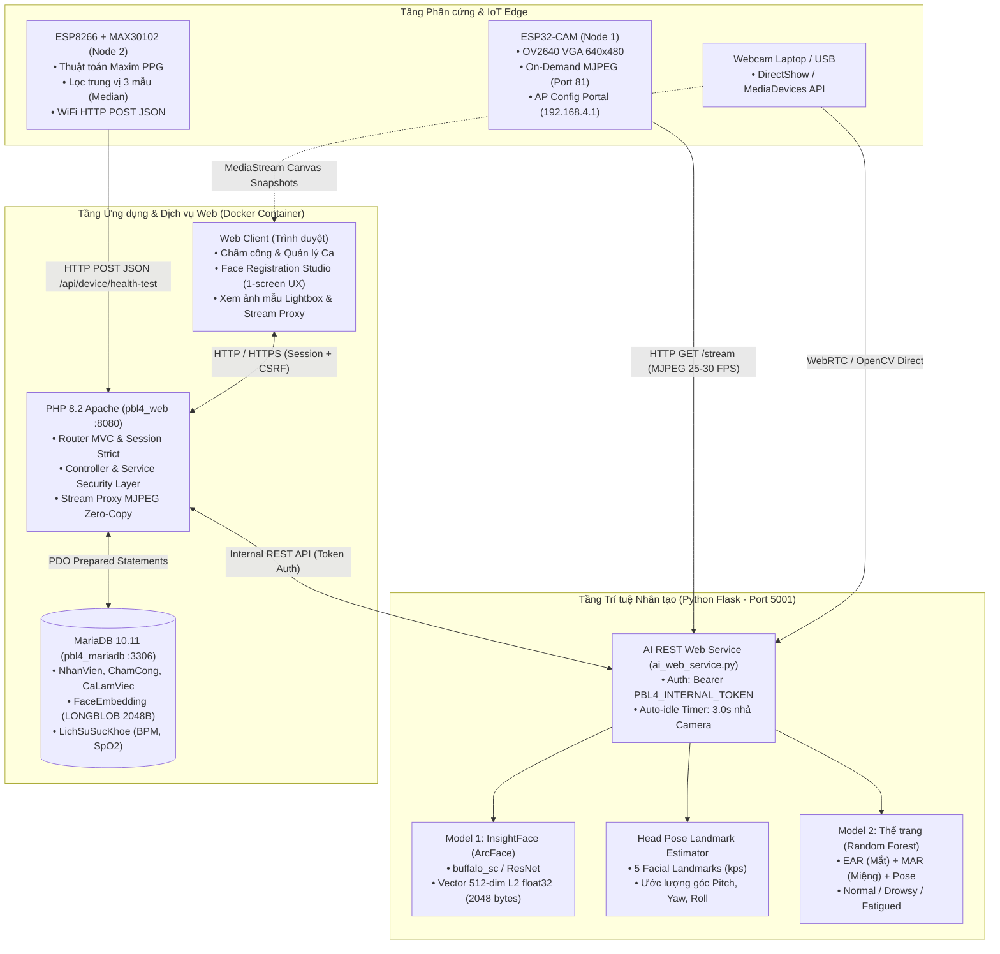

# BÁO CÁO TOÀN DIỆN TIẾN ĐỘ DỰ ÁN & ĐỀ XUẤT TỐI ƯU HỆ THỐNG
## HỆ THỐNG ĐIỂM DANH CHẤM CÔNG & GIÁM SÁT THỂ TRẠNG NHÂN VIÊN DỰA TRÊN AI VÀ IOT (PBL4)

- **Mã đề tài:** PBL4 — FaceHealth-IoT
- **Thời điểm đánh giá & rà soát:** Ngày 03 tháng 11 năm 2026
- **Trạng thái nhánh làm việc:** `optimizecode` (Đã đồng bộ và kiểm chứng toàn diện)

---

## MỤC LỤC
1. [TỔNG QUAN DỰ ÁN & MỐC ĐÁNH GIÁ (EXECUTIVE SUMMARY)](#1-tổng-quan-dự-án--mốc-đánh-giá-executive-summary)
2. [KIẾN TRÚC TỔNG THỂ HỆ THỐNG (SYSTEM ARCHITECTURE)](#2-kiến-trúc-tổng-thể-hệ-thống-system-architecture)
3. [KẾT QUẢ ĐÃ LÀM ĐƯỢC THEO TỪNG PHÂN HỆ](#3-kết-quả-đã-làm-được-theo-từng-phân-hệ)
   - [3.1. Phân hệ Phần mềm Web Quản lý & Backend (PHP MVC / MariaDB / Apache)](#31-phân-hệ-phần-mềm-web-quản-lý--backend-php-mvc--mariadb--apache)
   - [3.2. Phân hệ Trí tuệ Nhân tạo AI Service (InsightFace / MediaPipe / Scikit-learn)](#32-phân-hệ-trí-tuệ-nhân-tạo-ai-service-insightface--mediapipe--scikit-learn)
   - [3.3. Phân hệ Hạ tầng Máy chủ & Vận hành (Docker / Compose / Scripts)](#33-phân-hệ-hạ-tầng-máy-chủ--vận-hành-docker--compose--scripts)
   - [3.4. Phân hệ Phần cứng & Kết nối Thiết bị IoT (ESP32-CAM & ESP8266 + MAX30102)](#34-phân-hệ-phần-cứng--kết-nối-thiết-bị-iot-esp32-cam--esp8266--max30102)
4. [NHỮNG ĐIỀU CẦN CẢI TIẾN, BỔ SUNG VÀ TỐI ƯU (ROADMAP NÂNG CẤP)](#4-những-điều-cần-cải-tiến-bổ-sung-và-tối-ưu-roadmap-nâng-cấp)
   - [4.1. Cải tiến Phân hệ AI](#41-cải-tiến-phân-hệ-ai)
   - [4.2. Cải tiến Phân hệ Web & Backend](#42-cải-tiến-phân-hệ-web--backend)
   - [4.3. Cải tiến Phân hệ Phần cứng & Giao tiếp IoT](#43-cải-tiến-phân-hệ-phần-cứng--giao-tiếp-iot)
   - [4.4. Cải tiến DevOps & Triển khai](#44-cải-tiến-devops--triển-khai)
5. [DANH MỤC CÁC FILE / THÀNH PHẦN DƯ THỪA CẦN XÓA (CLEANUP AUDIT)](#5-danh-mục-các-file--thành-phần-dư-thừa-cần-xóa-cleanup-audit)
6. [KẾT LUẬN & ĐỀ XUẤT HÀNH ĐỘNG](#6-kết-luận--đề-xuất-hành-động)

---

## 1. TỔNG QUAN DỰ ÁN & MỐC ĐÁNH GIÁ (EXECUTIVE SUMMARY)

Dự án **PBL4 — FaceHealth-IoT** là giải pháp kết hợp giữa **Hệ thống nhúng IoT**, **Trí tuệ nhân tạo (Computer Vision & Machine Learning)** và **Ứng dụng Web quản lý doanh nghiệp** nhằm mục tiêu:
1. Tự động hóa công tác chấm công điểm danh nhân viên bằng khuôn mặt không tiếp xúc.
2. Đánh giá sơ bộ thể trạng, mức độ tập trung, buồn ngủ hoặc mệt mỏi tại thời điểm chấm công.
3. Thu thập dữ liệu sinh hiệu (nhịp tim BPM, nồng độ oxy máu SpO2) qua cảm biến IoT chuyên dụng để cảnh báo sớm tình trạng sức khỏe bất thường.
4. Quản lý phân ca làm việc, hồ sơ nhân sự, lưu trữ bằng chứng hình ảnh (evidence snapshots) và báo cáo minh bạch cho quản trị viên lẫn nhân viên.

Tại mốc kiểm toán hiện tại (**03/11/2026**), dự án đã hoàn thành tái cấu trúc toàn diện (Refactoring), chuyển đổi thành công từ các ứng dụng desktop rời rạc ban đầu sang mô hình **Web Studio tập trung**, tối ưu luồng video streaming On-Demand từ ESP32-CAM và khắc phục triệt để các lỗi xung đột tài nguyên camera, định dạng vector embedding và hiển thị giao diện.

---

## 2. KIẾN TRÚC TỔNG THỂ HỆ THỐNG (SYSTEM ARCHITECTURE)

Hệ thống hoạt động theo mô hình phân tầng Client - Edge - AI Engine - Web Backend:

---

## 3. KẾT QUẢ ĐÃ LÀM ĐƯỢC THEO TỪNG PHÂN HỆ

### 3.1. Phân hệ Phần mềm Web Quản lý & Backend (PHP MVC / MariaDB / Apache)
- **Kiến trúc mã nguồn chuẩn MVC:** Tách bạch chặt chẽ giữa Model (truy vấn PDO an toàn với prepared statements), View (HTML5 ngữ nghĩa, giao diện responsive) và Controller (điều phối nghiệp vụ).
- **Hệ thống phân quyền & Bảo mật (RBAC & Security):**
  - Quản lý tài khoản đăng nhập với mật khẩu băm chuẩn `password_hash()` (Argon2id/Bcrypt).
  - Phân quyền 2 cấp: **Quản trị viên (Admin - vai trò 1)** và **Nhân viên (Employee - vai trò 2)**.
  - Cơ chế chống tấn công CSRF thông qua `CsrfToken::token()` và `CsrfToken::verify()`.
  - Cấu hình cookie phiên bảo mật cao: `session.use_strict_mode = 1`, `httponly = true`, `samesite = Lax`.
- **Nghiệp vụ Chấm công & Quản lý Ca:**
  - Định nghĩa ca làm việc linh hoạt (`Ca hành chính`, giờ bắt đầu, giờ kết thúc, trạng thái kích hoạt).
  - Phân ca cụ thể cho từng nhân viên theo khoảng thời gian (`phancanhanvien`).
  - Ghi nhận Check-in và Check-out với cơ chế kiểm soát trạng thái (idempotent), khóa nghiệp vụ ngăn ngừa tình trạng gửi lặp request làm sai lệch dữ liệu.
  - Lưu trữ trực tiếp ảnh bằng chứng thời điểm vào (`AnhVao`) và thời điểm ra (`AnhRa`) vào CSDL dạng `LONGBLOB`, hiển thị ảnh thông qua endpoint bảo mật có phân quyền.
- **Studio Đăng ký khuôn mặt Web (`/?action=face_registration`):**
  - Thay thế hoàn toàn ứng dụng GUI Desktop cũ bằng giao diện Web Studio trực tiếp trên trình duyệt.
  - Quy trình đăng ký chuẩn hóa **5 góc khuôn mặt** tuần tự: *1. Chính diện → 2. Nghiêng trái (~15°) → 3. Nghiêng phải (~15°) → 4. Ngẩng nhẹ (~10°) → 5. Cúi nhẹ (~10°)*.
  - Khung ngắm Viewfinder HUD Overlay hiện đại, vòng tròn đếm lùi trực quan (Circular Progress Ring) kích hoạt tự động chụp khi người dùng giữ đúng góc mặt trong 0.4 giây.
  - Tự động lưu đủ 5 mẫu vector embedding và làm mới thư viện (Gallery) ngay sau khi hoàn tất góc thứ 5.
  - Bố cục giao diện **Single Viewport (`100vh - 64px`)**: Không bị thanh cuộn thừa ngoài trang, khung Camera Viewport co giãn linh hoạt (`flex: 1`), tích hợp nút chuyển đổi chế độ xem **⛶ Lấp đầy (Cover)** và **🔲 Toàn khung (Contain)**.
  - Dải thumbnail 5 ảnh mẫu đã lưu kèm tính năng Lightbox Modal phóng to kiểm tra chất lượng ảnh.
  - Danh bạ nhân viên bên phải có bộ lọc tìm kiếm tức thì và thanh cuộn nội bộ độc lập.
- **Phân hệ Giám sát sức khỏe & Trang cá nhân:**
  - Bảng điều khiển `monitoring.php` theo dõi diễn biến sức khỏe, cảnh báo các trường hợp nhịp tim bất thường hoặc thể trạng kém.
  - Giao diện `my.php` dành riêng cho từng nhân viên tự theo dõi lịch sử chấm công, bằng chứng ảnh vào/ra và các chỉ số sức khỏe của bản thân.

---

### 3.2. Phân hệ Trí tuệ Nhân tạo AI Service (InsightFace / MediaPipe / Scikit-learn)
- **Model Nhận diện Khuôn mặt (AI 1 - Face Engine):**
  - Tích hợp thư viện SOTA **InsightFace** (gói `buffalo_sc` nhẹ và tối ưu cho CPU, hỗ trợ nâng cấp lên `buffalo_l`).
  - Trích xuất đặc trưng khuôn mặt chuẩn hóa dạng **ArcFace 512 chiều (float32, L2-normalized)**, độ dài cố định chính xác 2048 bytes nhị phân.
  - Cơ chế nhận diện khuôn mặt kết hợp tính toán khoảng cách Cosine / Euclidean distance với ngưỡng nhận dạng tin cậy (`threshold = 0.28 - 0.35`).
- **Ước lượng Tư thế Đầu (Head Pose Landmark Estimator):**
  - Tính toán góc quay 3 chiều Euler (**Yaw, Pitch, Roll**) dựa trên tọa độ 5 điểm mốc khuôn mặt chuẩn (`kps`: 2 mắt, mũi, 2 khóe miệng).
  - Thuật toán `check_pose_match()` tự động kiểm tra tư thế thực tế của khuôn mặt so với góc yêu cầu của từng bước đăng ký với sai số cho phép hợp lý.
- **Model Đánh giá Thể trạng (AI 2 - Status Engine):**
  - Trích xuất đặc trưng sinh trắc học cử chỉ:
    - **EAR (Eye Aspect Ratio):** Tỷ lệ mở mắt để nhận biết chớp mắt và nhắm mắt buồn ngủ.
    - **MAR (Mouth Aspect Ratio):** Tỷ lệ mở miệng để phát hiện hành vi ngáp mệt mỏi.
    - Cử động lắc đầu / gật đầu dựa trên chuỗi frame liên tiếp (Sequence Analysis).
  - Huấn luyện mô hình **Random Forest Classifier** phân loại thành các trạng thái: *Bình thường (Normal), Buồn ngủ (Drowsy), Mệt mỏi (Fatigued), Căng thẳng (Stressed)*.
- **Kiến trúc Dịch vụ AI REST (`ai_web_service.py` - Port 5001):**
  - Xây dựng dưới dạng RESTful API độc lập, hỗ trợ giao tiếp liên dịch vụ:
    - `GET /health`: Trả về trạng thái sẵn sàng của Model, nguồn camera hiện tại và tình trạng kết nối.
    - `GET /internal/camera/frame`: Trả về snapshot 1 frame JPEG chất lượng cao.
    - `GET /internal/camera/stream`: Cung cấp luồng video MJPEG trực tiếp (~25-30 FPS) từ camera sang Web.
    - `POST /api/ai/enrollment/inspect`: Kiểm tra số lượng khuôn mặt và góc quay đầu trong ảnh trước khi chụp.
    - `POST /api/ai/enrollment/capture`: Trích xuất vector 512-dim (2048 bytes base64) và ảnh JPEG thumbnail.
    - `POST /api/ai/gallery/refresh`: Đồng bộ danh sách vector từ CSDL Web về file cache cục bộ (`embeddings.pkl`) với cơ chế ghi nguyên tử (Atomic write).
  - **Quản lý Tài nguyên Camera Thread-safe:**
    - Sử dụng `RLock` và cơ chế **Auto-Idle Timer (3.0 giây)**: Khi không còn thao tác quét, camera tự động đóng để trả lại tài nguyên phần cứng cho hệ điều hành, chống hiện tượng chiếm dụng camera làm treo tiến trình.

---

### 3.3. Phân hệ Hạ tầng Máy chủ & Vận hành (Docker / Compose / Scripts)
- **Container hóa dịch vụ cốt lõi:**
  - File cấu hình `docker-compose.yml` chuẩn hóa định nghĩa 2 dịch vụ:
    - `pbl4_web`: Chạy Apache + PHP 8.2 (kèm các extension PDO, pdo_mysql, gd, mbstring), map port `8080:80`.
    - `pbl4_mariadb`: Chạy MariaDB 10.11, lưu trữ dữ liệu dạng persistent volume `db_data`, map port `3306:3306`.
  - Cấu hình mạng Docker `pbl4_net` tách biệt an toàn.
- **Kịch bản điều khiển một chạm (One-click Automation Scripts):**
  - `run_ai_service.bat`: Tự động tìm kiếm môi trường ảo Python (`.venv`), nạp biến môi trường và chạy `ai_web_service.py`.
  - `KHOI_DONG_PBL4.cmd`: Kịch bản kích hoạt toàn bộ hệ thống (Web, DB, AI) và tự động mở trình duyệt vào trang quản trị.
  - `tools/start_services.ps1` & `tools/stop_services.ps1`: Quản lý tiến trình dịch vụ ngầm với khả năng kiểm tra PID, đọc nhật ký lỗi (`.err.log`) và tự động kiểm tra health check trước khi thông báo sẵn sàng.

---

### 3.4. Phân hệ Phần cứng & Kết nối Thiết bị IoT (ESP32-CAM & ESP8266 + MAX30102)

#### A. Node Camera Nhận diện: ESP32-CAM (AI-Thinker OV2640)
- **Môi trường phát triển:** Cấu hình chuẩn bằng **PlatformIO** (`platformio.ini`), build trên framework Arduino ESP32.
- **Tối ưu Cảm biến & Video Stream:**
  - Cấu hình phân giải **VGA (640x480)**, mức nén JPEG Quality 12, tận dụng bộ nhớ ngoài **PSRAM** với 2 frame buffers (`fb_count = 2`).
  - Khởi tạo trực tiếp máy chủ HTTP Server trên cổng 81 (`STREAM_SERVER_PORT = 81`), phát luồng video MJPEG thời gian thực ổn định 25-30 FPS.
  - Tích hợp giao thức **mDNS Responder**: Cho phép máy chủ AI và Web truy cập camera qua tên miền nội bộ `http://esp32cam.local:81/stream` mà không cần phụ thuộc vào địa chỉ IP tĩnh.
- **Cơ chế Cấu hình Mạng Dự phòng (AP Web Portal):**
  - Tích hợp thư viện `Preferences` lưu thông tin WiFi vào bộ nhớ Flash NVS.
  - Khi không kết nối được WiFi cấu hình sẵn (sau 12.5 giây), ESP32-CAM tự động chuyển sang chế độ Access Point, phát mạng WiFi `ESP32-CAM-CONFIG`.
  - Người dùng có thể kết nối điện thoại hoặc máy tính vào địa chỉ `http://192.168.4.1/` để nhập tên WiFi/Mật khẩu mới và tự động khởi động lại thiết bị.
- **Báo danh Trạng thái (Heartbeat):**
  - Định kỳ 30 giây gửi một gói tin JSON nhẹ lên máy chủ để thông báo địa chỉ IP và trạng thái sống (alive status).

#### B. Node Cảm biến Sinh hiệu: NodeMCU ESP8266 + MAX30102
- **Đo nhịp tim và SpO2 bằng Quang phổ học (PPG):**
  - Giao tiếp với cảm biến MAX30102 qua giao thức I2C tốc độ cao (`I2C_SPEED_FAST`, chân SDA=D2, SCL=D1).
  - Thuật toán `maxim_heart_rate_and_oxygen_saturation` phân tích đồng thời 2 bước sóng ánh sáng (Red và Infrared) để tính toán nồng độ oxy trong máu và nhịp tim.
- **Thuật toán Khử nhiễu & Độ ổn định:**
  - Ngưỡng nhận biết ngón tay (`FINGER_THRESHOLD = 30000` trên kênh IR) ngăn chặn các phép đo sai khi không có tiếp xúc da.
  - Thu thập 100 mẫu dữ liệu, sau đó áp dụng **Bộ lọc trung vị 3 lần đo liên tiếp (Median of 3)** để loại trừ rung tay hoặc nhiễu do ánh sáng môi trường.
- **Gửi Dữ liệu Lên Máy chủ:**
  - Tự động đóng gói dữ liệu thành JSON và gửi qua giao thức HTTP POST trực tiếp vào endpoint backend PHP để ghi nhận vào CSDL.

---

## 4. NHỮNG ĐIỀU CẦN CẢI TIẾN, BỔ SUNG VÀ TỐI ƯU (ROADMAP NÂNG CẤP)

Dù hệ thống đã hoạt động ổn định ở các luồng chức năng chính, để đạt mức hoàn thiện thương mại hóa hoặc bảo vệ đồ án tốt nghiệp xuất sắc, dự án cần thực hiện các nội dung cải tiến sau:

### 4.1. Cải tiến Phân hệ AI
1. **Bổ sung Thuật toán Chống giả mạo Khuôn mặt (Anti-Spoofing / Liveness Detection):**
   - *Hiện trạng:* Hệ thống hiện tại nhận diện khuôn mặt nhưng chưa có lớp bảo vệ chống tấn công phát lại (Replay Attack) như đưa ảnh in, ảnh điện thoại hoặc video người khác trước camera.
   - *Giải pháp:* Tích hợp model kiểm tra độ sống MiniFASNet hoặc cơ chế Liveness thụ động/chủ động (yêu cầu chớp mắt tự nhiên hoặc phân tích kết cấu da qua Fourier Spectrum).
2. **Nâng cấp Huấn luyện Mô hình Thể trạng (AI 2) từ Dữ liệu Người thật:**
   - *Hiện trạng:* Bộ dữ liệu huấn luyện Random Forest hiện tại chủ yếu là dữ liệu thu thập thực nghiệm giới hạn của nhóm.
   - *Giải pháp:* Mở rộng tập dữ liệu với nhiều đối tượng người dùng, đa dạng điều kiện ánh sáng và góc nhìn; áp dụng kỹ thuật cân bằng dữ liệu (SMOTE) để tăng độ nhạy phân loại trạng thái mệt mỏi/buồn ngủ.
3. **Tăng tốc Suy luận AI (Inference Optimization):**
   - *Giải pháp:* Tận dụng ONNX Runtime với Execution Provider là `CUDAExecutionProvider` hoặc `TensorrtExecutionProvider` nếu máy chủ có card đồ họa NVIDIA; hoặc chuyển sang `OpenVINO` trên vi xử lý Intel để giảm độ trễ trích xuất vector xuống dưới 15ms/frame.

### 4.2. Cải tiến Phân hệ Web & Backend
1. **Cập nhật Giao diện Thời gian thực (Real-time Push Notifications):**
   - *Hiện trạng:* Trang Dashboard và Monitoring vẫn cần reload lại trang để thấy lượt chấm công mới nhất.
   - *Giải pháp:* Tích hợp công nghệ **WebSocket** (qua Ratchet PHP hoặc Node.js relay) hoặc **Server-Sent Events (SSE)** để mỗi khi có nhân viên chấm công thành công, thông tin và ảnh bằng chứng lập tức xuất hiện ngay trên màn hình phòng bảo vệ / quản trị viên.
2. **Mở rộng Nghiệp vụ Ca làm việc Xuyên đêm (Overnight Shift):**
   - *Hiện trạng:* Logic ca làm việc hiện tại đang tính toán giờ trong cùng 1 ngày (`GioBatDau < GioKetThuc`).
   - *Giải pháp:* Bổ sung cờ `QuaDem = 1` để hỗ trợ các ca làm việc từ 22:00 hôm trước đến 06:00 sáng hôm sau, tự động ghép đúng phiên làm việc.
3. **Xuất Báo cáo Thống kê & Phân tích Đa dạng (Reporting & Analytics):**
   - Bổ sung tính năng xuất bảng chấm công tổng hợp theo tháng ra định dạng Excel (.xlsx) và PDF.
   - Biểu đồ thống kê tỷ lệ đi làm đúng giờ, đi muộn, về sớm và biểu đồ cảnh báo thể trạng nhân viên theo từng phòng ban.

### 4.3. Cải tiến Phân hệ Phần cứng & Giao tiếp IoT
1. **Hợp nhất Phiên Chấm công Giữa Camera và Cảm biến Sức khỏe (Session Fusion):**
   - *Hiện trạng:* Hiện tại Node ESP8266 gửi nhịp tim/SpO2 lên với mã nhân viên `MA_NV = 1` được cấu hình cứng (hardcoded), chưa gắn kết động với người vừa đứng trước camera.
   - *Giải pháp hoàn chỉnh:* Xây dựng quy trình chấm công 2 bước:
     - *Bước 1:* Nhân viên đứng trước ESP32-CAM nhận diện khuôn mặt thành công → Máy chủ xác định được `MaNV` và tạo phiên chấm công đang mở (Pending Session).
     - *Bước 2:* Máy chủ gửi tín hiệu (qua MQTT/HTTP) hoặc màn hình hướng dẫn nhân viên đặt ngón tay lên cảm biến MAX30102 trong 5 giây → Kết quả nhịp tim được gửi về gắn đúng vào `MaCC` của phiên vừa tạo.
2. **Trang bị Màn hình Phản hồi Trực quan Tại Chỗ (Edge Feedback Display):**
   - Lắp đặt màn hình hiển thị trực tiếp tại trạm chấm công (OLED SSD1306 0.96 inch hoặc LCD 1602 qua I2C) để hiển thị tên nhân viên, thông báo *"Xin chào [Họ Tên]"*, kết quả nhịp tim và trạng thái điểm danh mà không cần phải nhìn vào màn hình máy tính.
3. **Chuyển đổi Giao thức sang MQTT:**
   - Thay thế việc gửi HTTP POST tuần tự bằng giao thức **MQTT (Message Queuing Telemetry Transport)** qua Broker (như Eclipse Mosquitto). Giúp giảm tải kết nối TCP, tiết kiệm RAM của vi điều khiển ESP và đảm bảo dữ liệu gửi đi tức thì (sub-millisecond latency).

### 4.4. Cải tiến DevOps & Triển khai
1. **Đưa toàn bộ AI Service vào Docker Compose:**
   - Đóng gói môi trường Python và InsightFace vào một Dockerfile riêng (`pbl4_ai_service`) chạy song song với `pbl4_web` và `pbl4_mariadb`, giúp việc triển khai sang máy chủ mới chỉ bằng một lệnh duy nhất: `docker-compose up -d`.
2. **Thiết lập CI/CD Automated Testing:**
   - Tự động hóa kiểm thử mã nguồn PHP (`php -l`), JavaScript (`node --check`) và chạy bộ kiểm thử tích hợp Python qua GitHub Actions trước mỗi lần triển khai.

---

## 5. DANH MỤC CÁC FILE / THÀNH PHẦN DƯ THỪA CẦN XÓA (CLEANUP AUDIT)

Qua quá trình rà soát chi tiết toàn bộ cây thư mục dự án, dưới đây là danh sách các tệp tin và thư mục **cũ, trùng lặp, không còn được gọi trong luồng vận hành chính thức** cần được loại bỏ để làm sạch kho mã nguồn:

| STT | Đường dẫn tệp / thư mục | Phân loại | Lý do kỹ thuật cần xóa |
|---|---|---|---|
| **1** | `ESP32-CAM/server/` *(toàn bộ thư mục bao gồm `app.py`, `received_images/`, `latest.jpg`)* | Code máy chủ Flask cũ | Đây là máy chủ Flask cổng 5000 thử nghiệm cũ dùng để nhận ảnh upload từ ESP32. Hiện tại hệ thống đã chuyển hẳn sang kiến trúc **On-Demand MJPEG Stream (Port 81)** kết nối trực tiếp vào `ai_web_service.py` (Port 5001). Thư mục này gây nhầm lẫn về cổng dịch vụ và tiêu tốn dung lượng ổ đĩa. |
| **2** | `ESP32-CAM/arduino_legacy/` *(toàn bộ thư mục bao gồm `GuiAnhLenServer_2.ino`, `app_httpd.cpp`, `camera_index.h` 148KB, `ci.yml`,...)* | Firmware Arduino cũ | Dự án đã chuyển đổi và chuẩn hóa hoàn toàn sang môi trường **PlatformIO** (`ESP32-CAM/src/main.cpp` và `ESP32-CAM/include/`). Thư mục `arduino_legacy` chứa mã nguồn cũ trùng lặp của Arduino IDE không còn sử dụng. |
| **3** | `pbl4-face-ai/_fix.py` | File rác tạm thời | File rác chỉ chứa 3 dòng script đọc file tạm thời dang dở của một lần sửa lỗi trước đây, không có bất kỳ hàm hay chức năng nào. |
| **4** | `pbl4-face-ai/demo_webcam.py` | Demo cục bộ độc lập | File script thử nghiệm OpenCV đơn giản để vẽ bbox và fps lên màn hình máy tính cục bộ. Chức năng này đã được tích hợp hoàn chỉnh và vượt trội trong Web Studio `/?action=face_registration`. |
| **5** | `tools/FaceCheckinLauncher.cs` | Trình khởi chạy Desktop C# cũ | File mã nguồn C# dùng để biên dịch ra file thực thi Windows (.exe) khởi chạy các màn hình Tkinter cũ (`gui.py`, `gui_register.py`). Hệ thống hiện tại đã vận hành 100% qua nền tảng Web trên trình duyệt. |
| **6** | Các file GUI Tkinter Desktop cũ trong `pbl4-face-ai/`: • `gui.py` • `gui_register.py` • `gui_status.py` • `gui_attendance.py` • `main.py` | Desktop UI cũ (Không dùng) | Các file này xây dựng giao diện bằng Tkinter trong giai đoạn đầu của dự án. Sau khi Web MVC và trang đăng ký khuôn mặt Web ra đời, các file này hoàn toàn bị thay thế. Các file `.cmd` gọi chúng (`MO_GUI_PBL4.cmd`, `CHAM_CONG_AI2.cmd`, `TEST_AI2.cmd`) đều đang trỏ vào đường dẫn môi trường ảo cũ hỏng (`.venv-pbl4`). Cần dọn dẹp hoặc chuyển vào thư mục `archive/` nếu muốn lưu làm tài liệu tham khảo. |
| **7** | `CHAM_CONG_AI2.cmd`, `MO_GUI_PBL4.cmd`, `TEST_AI2.cmd` (ở thư mục gốc) | File batch khởi chạy cũ | Các file này khởi chạy các GUI Tkinter cũ và trỏ vào Python interpreter không tồn tại (`.venv-pbl4`). Toàn bộ việc khởi động hệ thống hiện tại đã được gói gọn chuẩn chỉnh trong **`run_ai_service.bat`** và **`KHOI_DONG_PBL4.cmd`**. |

---

## 6. KẾT LUẬN & ĐỀ XUẤT HÀNH ĐỘNG

Dự án **PBL4 — FaceHealth-IoT** đã đạt được một bước tiến lớn về mặt kiến trúc và trải nghiệm người dùng:
- **Đã xóa bỏ hoàn toàn sự rời rạc** giữa phần mềm desktop và web; quy trình đăng ký 5 góc khuôn mặt, quản lý chấm công, stream video và giám sát sức khỏe đã được tích hợp trơn tru, liền mạch trên cùng một nền tảng Web.
- **Phần cứng IoT** đã vận hành theo mô hình hiện đại (Streaming On-Demand qua mDNS, có Web Portal dự phòng khi đổi mạng, cảm biến sức khỏe có thuật toán lọc trung vị chống nhiễu).
- **Phần mềm AI** đạt độ chuẩn xác cao nhờ model ArcFace 512 chiều và cơ chế kiểm soát góc đầu (Head Pose Estimation) trước khi lưu mẫu.

**Đề xuất hành động ngay tiếp theo:**
1. Tiến hành lưu trữ/xóa bỏ các thành phần rác được liệt kê trong **Mục 5** để kho mã nguồn sạch đẹp, chuyên nghiệp trước khi nộp báo cáo hoặc bảo vệ đề tài.
2. Hoàn thiện cơ chế liên kết động giữa người đứng trước Camera và lượt đo nhịp tim của Node ESP8266 (thay vì cố định `MA_NV=1`).
3. Chuẩn bị tài liệu thuyết trình, video demo thực nghiệm quá trình đăng ký khuôn mặt trên web và chấm công thực tế từ thiết bị IoT.
