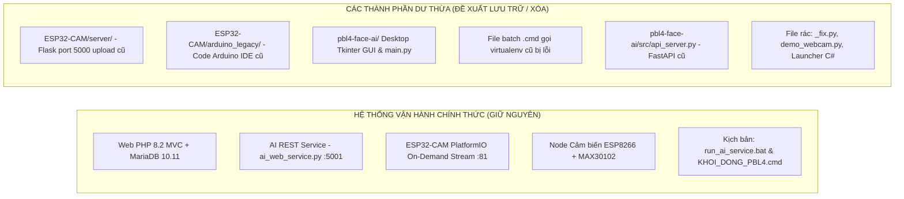

# DANH MỤC CÁC TỆP TIN & THÀNH PHẦN DƯ THỪA, KHÔNG SỬ DỤNG CẦN DỌN DẸP
## DỰ ÁN PBL4: HỆ THỐNG ĐIỂM DANH CHẤM CÔNG & GIÁM SÁT THỂ TRẠNG DỰA TRÊN AI VÀ IOT

- **Ngày lập tài liệu:** 03/11/2026
- **Trạng thái nhánh:** `optimizecode`
- **Mục đích:** Hướng dẫn kiểm toán chi tiết, phân loại và dọn dẹp các mã nguồn cũ, file rác tạm thời, firmware trùng lặp và các file khởi chạy lỗi thời nhằm làm sạch kho mã nguồn trước khi nộp đồ án / triển khai chính thức.

---

## 1. TỔNG QUAN DỌN DẸP (CLEANUP SUMMARY)

Qua các giai đoạn phát triển (từ thử nghiệm mô hình desktop ban đầu đến khi hoàn thiện hệ thống Web Studio tập trung), một số module đã hoàn thành sứ mệnh lịch sử và không còn được gọi trong luồng hoạt động chính thức.



### Bảng Thống kê Tóm tắt:
| Nhóm thành phần | Số lượng file | Ước tính dung lượng | Mức độ rủi ro khi xóa | Đề xuất xử lý |
|---|---|---|---|---|
| **Nhóm 1: Server Flask 5000 & Firmware Arduino cũ** | ~10 file + thư mục ảnh | ~160 KB code + ảnh test | **0% rủi ro (An toàn tuyệt đối)** | Di chuyển vào `archive_legacy/` hoặc Xóa |
| **Nhóm 2: Giao diện Desktop Tkinter cũ** | 6 file (.py, .cs) | ~110 KB | **0% rủi ro (An toàn tuyệt đối)** | Di chuyển vào `archive_legacy/` |
| **Nhóm 3: File Script khởi chạy (.cmd) bị lỗi** | 4 file (.cmd) | ~1 KB | **0% rủi ro (An toàn tuyệt đối)** | Xóa bỏ trực tiếp |
| **Nhóm 4: Server thử nghiệm & File rác dở dang** | 5 file (.py) | ~25 KB | **0% rủi ro (An toàn tuyệt đối)** | Di chuyển vào `archive_legacy/` hoặc Xóa |
| **Nhóm 5: File Log tạm & Cache biên dịch** | Tùy thời điểm | ~5 - 50 MB | **0% rủi ro (An toàn tuyệt đối)** | Dọn dẹp tự động |

---

## 2. CHI TIẾT TỪNG NHÓM TỆP TIN CẦN XÓA / ĐÓNG GÓI LƯU TRỮ

---

### NHÓM 1: MÁY CHỦ NHẬN ẢNH & FIRMWARE ESP32 CŨ (CỔNG 5000)

Thời kỳ đầu của dự án, nhóm thử nghiệm ESP32-CAM chụp ảnh JPEG và gửi bằng HTTP POST tuần tự lên máy chủ Flask cổng 5000. 
Hiện tại, hệ thống đã chuyển hẳn sang kiến trúc hiện đại: ESP32-CAM phát trực tiếp luồng video **MJPEG On-Demand trên cổng 81** (`http://esp32cam.local:81/stream`), máy chủ AI (`ai_web_service.py` cổng 5001) làm nhiệm vụ proxy mượt 25-30 FPS lên Web. Do đó toàn bộ các file sau hoàn toàn không còn sử dụng:

#### 1. `ESP32-CAM/server/app.py`
- **Đường dẫn:** `d:\PBL4\PBL4-FaceHealth-IoT\ESP32-CAM\server\app.py`
- **Chức năng cũ:** Máy chủ Flask cổng 5000 nhận ảnh POST `/upload` và trang HTML live feed cũ.
- **Lý do bỏ:** Xung đột cổng, tạo hiểu nhầm giữa cổng 5000 (cũ) và cổng 5001 (AI service thật). Không còn thiết bị nào gọi vào đây.

#### 2. `ESP32-CAM/server/received_images/` & `ESP32-CAM/server/latest.jpg`
- **Đường dẫn:** `d:\PBL4\PBL4-FaceHealth-IoT\ESP32-CAM\server\received_images\`
- **Chức năng cũ:** Thư mục lưu các file ảnh chụp test nhận từ ESP32-CAM.
- **Lý do bỏ:** Ảnh test cũ không còn giá trị, tiêu tốn dung lượng ổ đĩa.

#### 3. `ESP32-CAM/arduino_legacy/` (Toàn bộ thư mục)
- **Đường dẫn:** `d:\PBL4\PBL4-FaceHealth-IoT\ESP32-CAM\arduino_legacy\`
- **Các file bên trong:**
  - `GuiAnhLenServer_2.ino` (code Arduino IDE cũ)
  - `app_httpd.cpp`
  - `camera_index.h` (file header giao diện camera mặc định của Espressif, nặng **148 KB**)
  - `board_config.h`
  - `camera_pins.h` (trùng lặp với `ESP32-CAM/include/camera_pins.h`)
  - `partitions.csv`, `ci.yml`
- **Lý do bỏ:** Toàn bộ firmware ESP32-CAM chính thức của dự án đã được chuẩn hóa và quản lý bằng **PlatformIO** tại `ESP32-CAM/src/main.cpp` và `ESP32-CAM/include/config.h`. Thư mục này chỉ là bản nháp cũ của Arduino IDE.

---

### NHÓM 2: GIAO DIỆN DESKTOP TKINTER CŨ (ĐÃ THAY BẰNG WEB STUDIO)

Trước khi có giao diện Web MVC, nhóm phát triển các cửa sổ desktop bằng thư viện Tkinter của Python. Hiện tại, Web App PHP (`DoAn_ChamCong_AI`) đã hoàn thiện đầy đủ mọi tính năng vượt trội hơn hẳn:

#### 1. `pbl4-face-ai/gui_register.py`
- **Đường dẫn:** `d:\PBL4\PBL4-FaceHealth-IoT\pbl4-face-ai\gui_register.py`
- **Chức năng cũ:** Màn hình desktop Tkinter để chụp ảnh đăng ký khuôn mặt nhân viên.
- **Lý do bỏ:** Đã được thay thế hoàn toàn bằng **Web Studio Đăng ký khuôn mặt 5 góc** (`/?action=face_registration`), có vòng đếm lùi, thẩm định góc quay đầu và lưu tự động vào CSDL MariaDB.

#### 2. `pbl4-face-ai/gui.py` & `pbl4-face-ai/gui_attendance.py` & `pbl4-face-ai/gui_status.py`
- **Đường dẫn:** 
  - `d:\PBL4\PBL4-FaceHealth-IoT\pbl4-face-ai\gui.py`
  - `d:\PBL4\PBL4-FaceHealth-IoT\pbl4-face-ai\gui_attendance.py`
  - `d:\PBL4\PBL4-FaceHealth-IoT\pbl4-face-ai\gui_status.py`
- **Chức năng cũ:** Giao diện chấm công, dashboard và kiểm thử thể trạng trên máy tính desktop.
- **Lý do bỏ:** Các trang Web `/?action=attendance`, `/?action=dashboard` và `/?action=monitoring` đã đảm nhận hoàn hảo các nhiệm vụ này trên trình duyệt web đa nền tảng.

#### 3. `pbl4-face-ai/main.py`
- **Đường dẫn:** `d:\PBL4\PBL4-FaceHealth-IoT\pbl4-face-ai\main.py`
- **Chức năng cũ:** Menu dòng lệnh CLI hiển thị banner ASCII gọi các giao diện Tkinter cũ.
- **Lý do bỏ:** Không còn ai dùng dòng lệnh CLI này; toàn bộ luồng vận hành đã tự động hóa qua batch script và giao diện Web.

#### 4. `tools/FaceCheckinLauncher.cs`
- **Đường dẫn:** `d:\PBL4\PBL4-FaceHealth-IoT\tools\FaceCheckinLauncher.cs`
- **Chức năng cũ:** Mã nguồn C# dùng để biên dịch file thực thi `FaceCheckin.exe` khởi chạy các màn hình Tkinter ẩn console.
- **Lý do bỏ:** Không còn dùng ứng dụng Windows desktop, việc giữ lại file C# trong dự án Python/PHP/C++ gây nhiễu cấu trúc repo.

---

### NHÓM 3: CÁC FILE KỊCH BẢN KHỞI CHẠY (.CMD) BỊ LỖI ĐƯỜNG DẪN

Tại thư mục gốc của dự án có một số file `.cmd` được tạo ra trong quá trình thử nghiệm cũ:

| Tên file `.cmd` | Lệnh bên trong | Nguyên nhân lỗi & Lý do bỏ |
|---|---|---|
| `CHAM_CONG_AI2.cmd` | `".venv-pbl4\Scripts\python.exe" -u -B gui_attendance.py` | Đường dẫn ảo `.venv-pbl4` không tồn tại (venv thật là `.venv`). Gọi file GUI Tkinter cũ. |
| `MO_GUI_PBL4.cmd` | `".venv-pbl4\Scripts\python.exe" -B gui.py` | Lỗi venv không tồn tại. Gọi giao diện desktop cũ. |
| `TEST_AI2.cmd` | `".venv-pbl4\Scripts\python.exe" -u -B gui_status.py` | Lỗi venv không tồn tại. Gọi màn hình test thể trạng cũ. |
| `THU_CHECKIN_KHUON_MAT.cmd` | `".venv-pbl4\Scripts\python.exe" -B gui_attendance.py` | Trùng lặp với `CHAM_CONG_AI2.cmd`, trỏ vào venv hỏng. |

> [!NOTE]
> **Bộ kịch bản chuẩn hiện tại đang vận hành tốt:**
> 1. `run_ai_service.bat`: Tự động tìm `.venv`, khởi động AI REST Service trên cổng 5001.
> 2. `KHOI_DONG_PBL4.cmd`: Kích hoạt dịch vụ và mở trình duyệt `http://localhost:8080`.
> 3. `tools/start_services.ps1` và `tools/stop_services.ps1`: Điều khiển tiến trình ngầm có log.

---

### NHÓM 4: CÁC FILE SERVER THỬ NGHIỆM & SCRIPT DANG DỞ

#### 1. `pbl4-face-ai/_fix.py`
- **Đường dẫn:** `d:\PBL4\PBL4-FaceHealth-IoT\pbl4-face-ai\_fix.py`
- **Nội dung:** Chỉ chứa 3 dòng code dang dở:
  ```python
  import sys  
  with open('gui_register.py', 'rb') as f: raw = f.read() 
  ```
- **Lý do bỏ:** File rác tạm thời trong một lần debug encoding trước đây.

#### 2. `pbl4-face-ai/demo_webcam.py`
- **Đường dẫn:** `d:\PBL4\PBL4-FaceHealth-IoT\pbl4-face-ai\demo_webcam.py`
- **Chức năng cũ:** Script mở webcam cục bộ và vẽ bounding box, landmarks bằng OpenCV.
- **Lý do bỏ:** Script độc lập không kết nối CSDL, không phục vụ chấm công. Web Studio đã có đầy đủ khung ngắm và nhận diện chuẩn xác.

#### 3. `pbl4-face-ai/src/api_server.py`
- **Đường dẫn:** `d:\PBL4\PBL4-FaceHealth-IoT\pbl4-face-ai\src\api_server.py`
- **Chức năng cũ:** Server FastAPI (229 dòng) thử nghiệm nhận ảnh từ 2 ESP32-CAM qua POST `/api/attendance` và `/api/health`.
- **Lý do bỏ:** Dự án đã thống nhất sử dụng duy nhất **`pbl4-face-ai/ai_web_service.py`** (Flask REST Service bảo mật Bearer Token, port 5001). `api_server.py` không bao giờ được khởi động trong kịch bản chạy chính thức.

#### 4. Các script test UI Desktop trong `tools/`:
- `tools/test_status_ui.py`
- `tools/test_registration_ui.py`
- `tools/test_desktop_runtime.py`
- **Lý do bỏ:** Các test này viết cho UI Tkinter (`gui_status.py`, `gui_register.py`). Khi các UI này không còn dùng thì các test script này cũng không cần thiết trong pipeline.

---

### NHÓM 5: FILE LOG TẠM & CACHE BIÊN DỊCH

- `.pbl4-run/*.log`: Các file log chạy dịch vụ ngầm (ví dụ: `ai-20261028-155535.err.log`).
- `ESP32-CAM/.pio/`: Thư mục cache build của PlatformIO. Thư mục này hoàn toàn có thể tự sinh lại khi chạy lệnh `pio run` và nên được thêm vào `.gitignore` thay vì lưu trong git.

---

## 3. DANH MỤC CÁC TỆP TIN CỐT LÕI TUYỆT ĐỐI KHÔNG ĐƯỢC XÓA (WHITELIST)

Để đảm bảo hệ thống không bị gián đoạn hay thiếu hụt phụ thuộc, các file và thư mục sau **BẮT BUỘC PHẢI GIỮ LẠI NGUYÊN VẸN**:

### 1. Phân hệ Web & Backend (`DoAn_ChamCong_AI/`):
- `DoAn_ChamCong_AI/index.php` (Router chính)
- `DoAn_ChamCong_AI/Controller/*` (Toàn bộ 10 Controller: Auth, Employee, Shift, Attendance, FaceEnrollment, Monitoring,...)
- `DoAn_ChamCong_AI/Model/*` (Toàn bộ 11 Model: Database, EmployeeModel, FaceEmbeddingModel,...)
- `DoAn_ChamCong_AI/Service/*` (AiClient, FaceSample, AttendanceService, AttendancePayload, CameraFrameClient)
- `DoAn_ChamCong_AI/Security/*` (CsrfToken, InternalApi)
- `DoAn_ChamCong_AI/View/*` (Toàn bộ giao diện người dùng, đặc biệt là `face_registration.php`)
- `DoAn_ChamCong_AI/public/js/face_registration_page.js` (JavaScript điều khiển Web Studio)
- `doan_chamcong_ai_mariadb.sql` (Schema và dữ liệu mẫu MariaDB)
- `docker-compose.yml` (Cấu hình container Web và CSDL)

### 2. Phân hệ AI Engine (`pbl4-face-ai/`):
- `pbl4-face-ai/ai_web_service.py` (**Cốt lõi:** Service Flask API cổng 5001)
- `pbl4-face-ai/unified_engine.py` (**Cốt lõi:** Động cơ điều phối chấm công, fusion và kiểm tra phiên)
- `pbl4-face-ai/src/face_engine.py` (Trích xuất vector InsightFace 512 chiều)
- `pbl4-face-ai/src/verify.py` (Thuật toán đối khớp khuôn mặt Cosine/Euclidean)
- `pbl4-face-ai/src/enrollment_pose.py` (Ước lượng góc Pitch/Yaw/Roll kiểm tra 5 góc mặt)
- `pbl4-face-ai/src/camera_source.py` (Bộ chuyển đổi nguồn camera thông minh: ESP32-CAM hoặc Webcam)
- `pbl4-face-ai/src/predict_status.py` & `src/status_model.py` (Dự đoán thể trạng)
- `pbl4-face-ai/src/gallery_store.py` & `src/gallery_payload.py` (Đồng bộ thư viện khuôn mặt)
- `pbl4-face-ai/src/runtime_config.py` (Nạp biến môi trường và token an toàn)
- `pbl4-face-ai/demo_unified_iot.py` (Script demo kiểm thử giả lập sinh trắc học và kiểm tra engine)
- `pbl4-face-ai/scripts/collect_status.py` & `src/train_rf.py` (Công cụ thu thập dữ liệu và huấn luyện Random Forest)

### 3. Phân hệ IoT & Firmware:
- `ESP32-CAM/src/main.cpp` (**Cốt lõi:** Firmware PlatformIO điều khiển camera OV2640, On-demand Stream :81 và AP Web Portal)
- `ESP32-CAM/include/config.h` & `camera_pins.h` (Cấu hình chân và thông số mạng)
- `ESP32-CAM/platformio.ini` (Cấu hình môi trường nạp chip ESP32)
- `IoT_Integration/esp8266_max30102/esp8266_max30102.ino` (**Cốt lõi:** Firmware đọc cảm biến nhịp tim & SpO2)

### 4. Kịch bản Vận hành & Công cụ:
- `run_ai_service.bat` (Khởi động AI REST Service)
- `KHOI_DONG_PBL4.cmd` (Khởi động hệ thống)
- `tools/start_services.ps1` & `tools/stop_services.ps1` (Quản lý tiến trình dịch vụ ngầm)
- `tools/check_services.py` (Kiểm tra sức khỏe hệ thống)

---

## 4. HƯỚNG DẪN THỰC HIỆN DỌN DẸP AN TOÀN (SAFE ARCHIVING)

Để đảm bảo tuyệt đối không làm mất mã nguồn lịch sử nhưng vẫn giữ cho kho làm việc sạch sẽ, khuyến nghị thực hiện theo quy trình **Lưu trữ an toàn (Safe Archiving)** bằng PowerShell như sau:

### Bước 1: Tạo thư mục lưu trữ `archive_legacy/` và thêm vào `.gitignore`
Mở PowerShell tại thư mục gốc dự án:
```powershell
# 1. Tạo thư mục lưu trữ
New-Item -ItemType Directory -Path "archive_legacy" -Force

# 2. Thêm vào .gitignore để không bị theo dõi và đẩy lên GitHub
Add-Content -Path ".gitignore" -Value "`n# Legacy Archived Files`narchive_legacy/`n"
```

### Bước 2: Di chuyển các file không dùng vào thư mục lưu trữ
```powershell
# Di chuyển cụm ESP32 cũ
Move-Item -Path "ESP32-CAM\server" -Destination "archive_legacy\ESP32_server" -Force
Move-Item -Path "ESP32-CAM\arduino_legacy" -Destination "archive_legacy\ESP32_arduino_legacy" -Force

# Di chuyển cụm Desktop Tkinter GUI
Move-Item -Path "pbl4-face-ai\gui.py" -Destination "archive_legacy\" -Force
Move-Item -Path "pbl4-face-ai\gui_register.py" -Destination "archive_legacy\" -Force
Move-Item -Path "pbl4-face-ai\gui_attendance.py" -Destination "archive_legacy\" -Force
Move-Item -Path "pbl4-face-ai\gui_status.py" -Destination "archive_legacy\" -Force
Move-Item -Path "pbl4-face-ai\main.py" -Destination "archive_legacy\" -Force
Move-Item -Path "tools\FaceCheckinLauncher.cs" -Destination "archive_legacy\" -Force

# Di chuyển các script .cmd hỏng
Move-Item -Path "CHAM_CONG_AI2.cmd" -Destination "archive_legacy\" -Force
Move-Item -Path "MO_GUI_PBL4.cmd" -Destination "archive_legacy\" -Force
Move-Item -Path "TEST_AI2.cmd" -Destination "archive_legacy\" -Force
Move-Item -Path "THU_CHECKIN_KHUON_MAT.cmd" -Destination "archive_legacy\" -Force

# Di chuyển các file rác và server thử nghiệm cũ
Move-Item -Path "pbl4-face-ai\_fix.py" -Destination "archive_legacy\" -Force
Move-Item -Path "pbl4-face-ai\demo_webcam.py" -Destination "archive_legacy\" -Force
Move-Item -Path "pbl4-face-ai\src\api_server.py" -Destination "archive_legacy\" -Force
Move-Item -Path "tools\test_status_ui.py" -Destination "archive_legacy\" -Force
Move-Item -Path "tools\test_registration_ui.py" -Destination "archive_legacy\" -Force
Move-Item -Path "tools\test_desktop_runtime.py" -Destination "archive_legacy\" -Force
```

### Bước 3: Kiểm tra hồi quy sau khi di chuyển
Sau khi hoàn thành di chuyển, chạy kịch bản kiểm tra để đảm bảo hệ thống chính vẫn hoạt động trơn tru 100%:
1. Chạy `run_ai_service.bat` -> Kiểm tra cổng 5001 sẵn sàng.
2. Mở trình duyệt truy cập `http://localhost:8080/?action=face_registration` -> Kiểm tra Web Studio stream mượt mà và quét khuôn mặt bình thường.
3. Nếu sau 1-2 tuần hệ thống hoạt động ổn định và hoàn thành báo cáo đồ án, có thể xóa hẳn thư mục `archive_legacy/` để giải phóng dung lượng vĩnh viễn.
