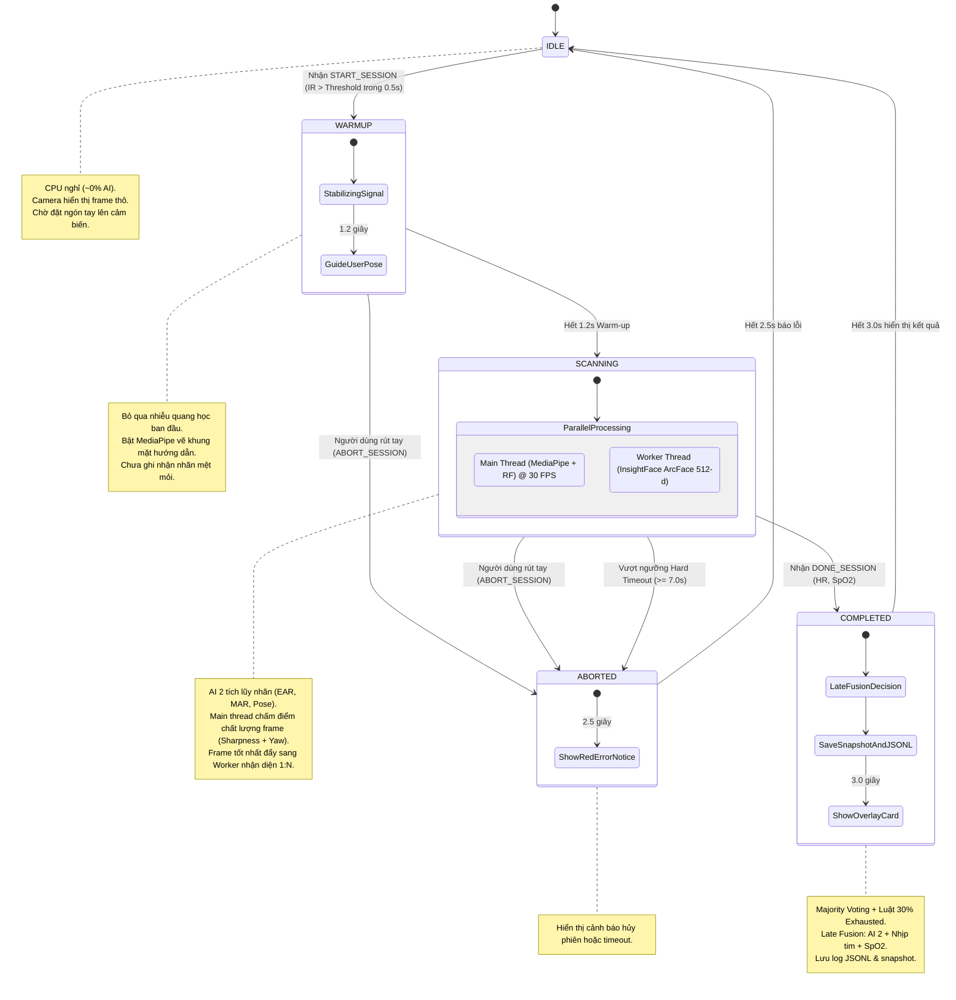
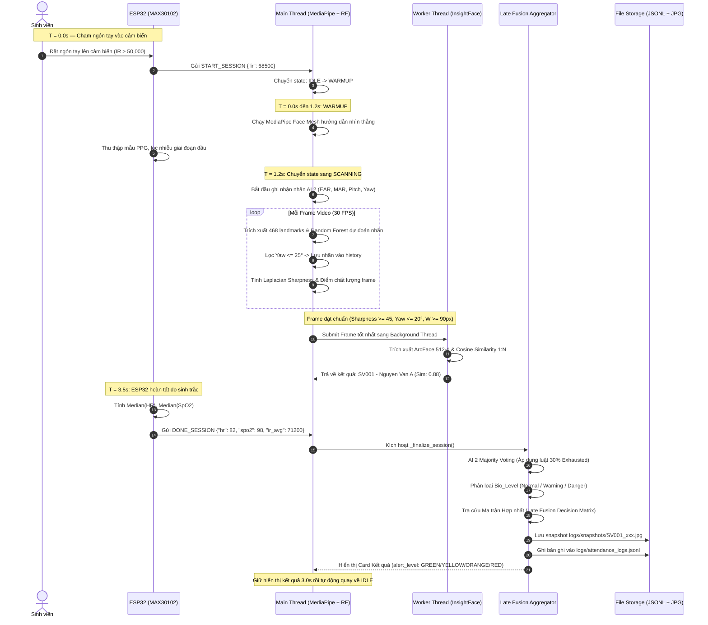

# KIẾN TRÚC HỆ THỐNG ĐIỂM DANH THÔNG MINH PBL4 (UNIFIED AI & IOT)

Hệ thống điểm danh sinh viên kết hợp **Nhận diện Danh tính (AI 1 — InsightFace)**, **Đánh giá Thể trạng Mệt mỏi (AI 2 — MediaPipe Face Mesh & Random Forest)** và **Cảm biến Sinh trắc học IoT (PPG MAX30102 qua ESP32)**.

---

## 1. Sơ đồ Máy trạng thái (State Diagram)

Hệ thống hoạt động theo mô hình **State Machine** 5 trạng thái nhằm tối ưu hóa tài nguyên phần cứng (CPU nghỉ ở `IDLE`), đảm bảo người dùng ổn định trước khi phân tích và tự động phục hồi sau lỗi.



---

## 2. Sơ đồ Tuần tự Tương tác (Sequence Diagram)

Mô tả trục thời gian xử lý ~3.5 – 4.0 giây từ lúc chạm cảm biến đến khi hoàn tất điểm danh:



---

## 3. Giao thức Truyền thông ESP32 ↔ PC (JSON Protocol)

Giao tiếp qua **Serial USB (115200 bps, JSON Lines)** hoặc **HTTP/WebSocket**:

### 3.1. Kích hoạt phiên (`START_SESSION`)
* **Điều kiện:** Cảm biến quang học MAX30102 phát hiện ngón tay (`irValue > IR_THRESHOLD`, mặc định 50,000) duy trì liên tục tối thiểu 0.5s.
* **Gói tin:**
  ```json
  {"event": "START_SESSION", "ir": 68500, "timestamp": 1710000000}
  ```

### 3.2. Hủy phiên giữa chừng (`ABORT_SESSION`)
* **Điều kiện:** Người dùng rút ngón tay ra trước khi hoàn tất đo (`irValue < IR_THRESHOLD`).
* **Gói tin:**
  ```json
  {"event": "ABORT_SESSION", "reason": "FINGER_REMOVED"}
  ```

### 3.3. Hoàn tất đo sinh trắc (`DONE_SESSION`)
* **Điều kiện:** Sau 1.2s warm-up và 2.0s–2.5s lấy mẫu ổn định ($40 \le \text{HR} \le 200$, $70 \le \text{SpO}_2 \le 100$), ESP32 lấy **giá trị trung vị (Median)** để loại bỏ nhiễu đột biến và gửi gói tin:
* **Gói tin:**
  ```json
  {"event": "DONE_SESSION", "hr": 82, "spo2": 98, "ir_avg": 71200}
  ```

---

## 4. Ma trận Hợp nhất Quyết định (Late Fusion Decision Matrix)

Hệ thống kết hợp 2 nguồn dữ liệu độc lập: **Trạng thái hình thái khuôn mặt (`ai2_face_status`)** và **Chỉ số sinh tồn quang học (`hr`, `spo2`)**.

### 4.1. Tiêu chí phân loại Sinh trắc học (`bio_level`)
- **`Bio_Missing`**: Không đo được chỉ số (`hr <= 0` hoặc `spo2 <= 0`).
- **`Bio_Danger`**: $\text{HR} > 115$ hoặc $\text{HR} < 50$ **HOẶC** $\text{SpO}_2 < 94\%$.
- **`Bio_Warning`**: ($100 < \text{HR} \le 115$ hoặc $50 \le \text{HR} < 60$) **HOẶC** ($94\% \le \text{SpO}_2 < 96\%$).
- **`Bio_Normal`**: $60 \le \text{HR} \le 100$ **VÀ** $\text{SpO}_2 \ge 96\%$.

### 4.2. Bảng Ma trận Hợp nhất (Thứ tự ưu tiên từ 1 đến 7)

| Mức ưu tiên | Điều kiện AI 2 (`ai2_face_status`) | Điều kiện Sinh trắc (`bio_level`) | Kết luận Hợp nhất (`final_status`) | Mức cảnh báo (`alert_level`) | Diễn giải & Khuyến nghị |
| :---: | :---: | :---: | :--- | :---: | :--- |
| **1** | Bất kỳ | **`Bio_Danger`** | **CẢNH BÁO Y TẾ (Medical Alert)** | 🔴 **RED** | Chỉ số tim mạch/SpO2 bất thường. Cần nghỉ ngơi kiểm tra y tế ngay! |
| **2** | **`Exhausted`** | Bất kỳ (`Normal`/`Warning`) | **KIỆT SỨC / NGỦ GẬT (Exhausted)** | 🔴 **RED** | Mắt nhắm nghiền hoặc gật gù nặng ($\ge 30\%$ frames). Không đảm bảo an toàn học tập/làm việc. |
| **3** | **`Fatigue`** | **`Bio_Warning`** | **MỆT MỎI THỂ CHẤT (Physical Fatigue)** | 🟠 **ORANGE** | Có cả biểu hiện lờ đờ trên mặt lẫn nhịp tim/SpO2 suy giảm nhẹ. |
| **4** | **`Fatigue`** | **`Bio_Normal`** hoặc `Missing` | **BUỒN NGỦ / THIẾU NGỦ (Drowsy)** | 🟡 **YELLOW** | Chỉ số sinh tồn ổn định nhưng mắt/cơ mặt mỏi. Khuyến nghị rửa mặt tỉnh táo. |
| **5** | **`Normal`** | **`Bio_Warning`** | **TỈNH TÁO - TIM ĐẬP NHANH (Active/Stressed)** | 🟡 **YELLOW** | Khuôn mặt tỉnh táo nhưng nhịp tim hơi cao (vừa leo cầu thang hoặc căng thẳng). |
| **6** | **`Normal`** | **`Bio_Normal`** hoặc `Missing` | **ĐẠT CHUẨN (Fit to Study/Work)** | 🟢 **GREEN** | Trạng thái tinh thần và thể chất hoàn toàn ổn định. |
| **7** | **`Unknown`** | Bất kỳ | **CHƯA RÕ MẶT** | 🟡 **YELLOW** | Camera không bắt đủ góc mặt chuẩn, chỉ ghi nhận chỉ số sinh trắc học. |

---

## 5. Cấu trúc Bản ghi Output JSON Chuẩn

Mỗi phiên thành công sẽ xuất ra 1 dòng JSON vào `logs/attendance_logs.jsonl` và sẵn sàng đẩy sang SQL Server / REST API của `DoAn_ChamCong_AI`:

```json
{
  "timestamp": "2026-10-15 18:30:00",
  "student_id": "SV001",
  "student_name": "Nguyen Van A",
  "face_confidence": 0.875,
  "ai2_face_status": "Fatigue",
  "face_metrics": {
    "ear": 0.21,
    "mar": 0.04,
    "pitch": -15.2,
    "yaw": 3.1,
    "sharpness": 112.5
  },
  "iot_metrics": {
    "hr": 82,
    "spo2": 98,
    "bio_level": "Bio_Normal",
    "ir_avg": 71200
  },
  "fusion_result": {
    "final_status": "BUỒN NGỦ / THIẾU NGỦ (Drowsy)",
    "alert_level": "YELLOW",
    "recommendation": "Chỉ số sinh tồn ổn định nhưng mắt/cơ mặt mỏi. Khuyến nghị rửa mặt tỉnh táo."
  },
  "snapshot_path": "logs/snapshots/SV001_20261015_183000.jpg"
}
```

---

## 6. Ghi chú Học thuật & Vận hành Cảm biến Quang học PPG MAX30102

1. **Bản chất công nghệ PPG (Photoplethysmography):**
   - MAX30102 sử dụng 2 bước sóng LED: Đỏ (Red, ~660 nm) và Hồng ngoại (IR, ~880 nm) để đo sự biến thiên thể tích máu qua mao mạch đầu ngón tay.
   - Khi tim co bóp, lưu lượng máu động mạch tăng làm tăng hấp thụ ánh sáng. Thuật toán đếm đỉnh sóng AC/DC để suy ra nhịp tim (Heart Rate) và tỉ số $R = \frac{(AC/DC)_{Red}}{(AC/DC)_{IR}}$ để tính nồng độ oxy hòa tan trong máu ($\text{SpO}_2$).
2. **Cơ chế chống nhiễu chuyển động (Motion Artifacts):**
   - Trong 1.2 – 1.5 giây đầu tiên khi ngón tay mới tiếp xúc, áp lực đè lên mặt kính chưa đều, gây dao động mức cơ bản DC cực lớn. Hệ thống bắt buộc phải có giai đoạn **`WARMUP` (1.2s)** để loại bỏ hoàn toàn các mẫu đầu này.
   - Khi người dùng giữ ngón tay trong 2.0 – 2.5 giây tiếp theo, thay vì lấy giá trị trung bình cộng (dễ bị kéo lệch bởi đỉnh đột biến khi tay khẽ giật), ESP32 sử dụng **Thuật toán Trung vị (Median Filter)** trên mảng mẫu thu được để triệt tiêu ngoại lai.
3. **Ý nghĩa y khoa & sàng lọc ban đầu:**
   - Cảm biến MAX30102 trong đồ án được định vị là **thiết bị sàng lọc sớm (Non-diagnostic Pre-screening Tool)**, không thay thế thiết bị y tế chuyên dụng.
   - Khi kết hợp với AI phân tích nét mặt (Face Mesh), hệ thống tạo ra cái nhìn hai chiều (Dual-modality): vừa đánh giá được **căng thẳng tâm lý / mệt mỏi thần kinh** (qua mắt, cơ miệng, tư thế đầu), vừa đánh giá được **trạng thái tuần hoàn thể chất** (qua nhịp tim và nồng độ oxy).
